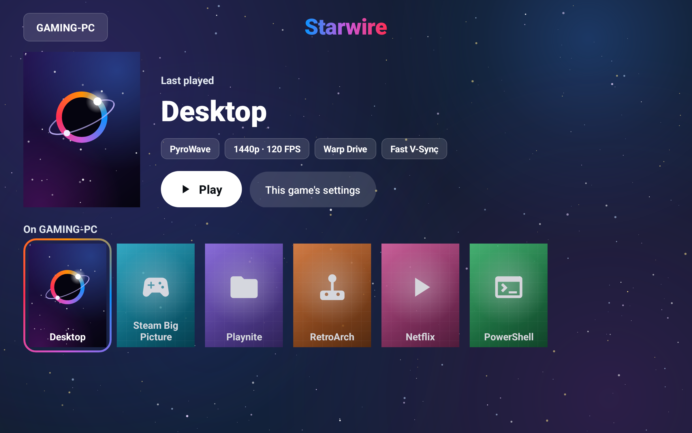
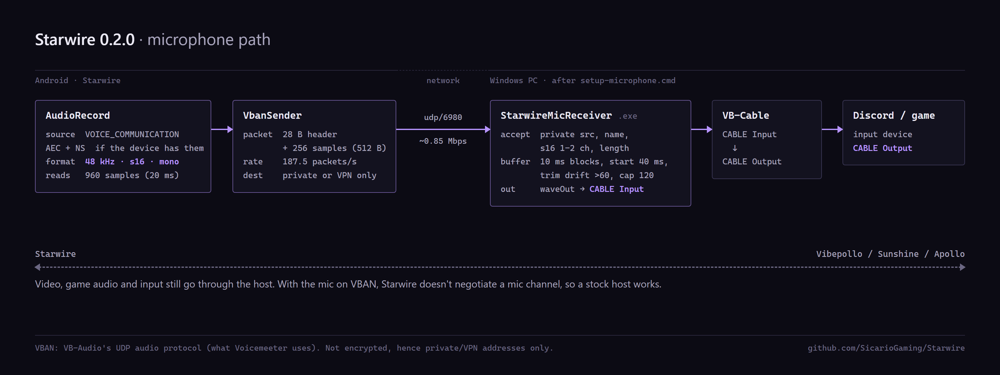
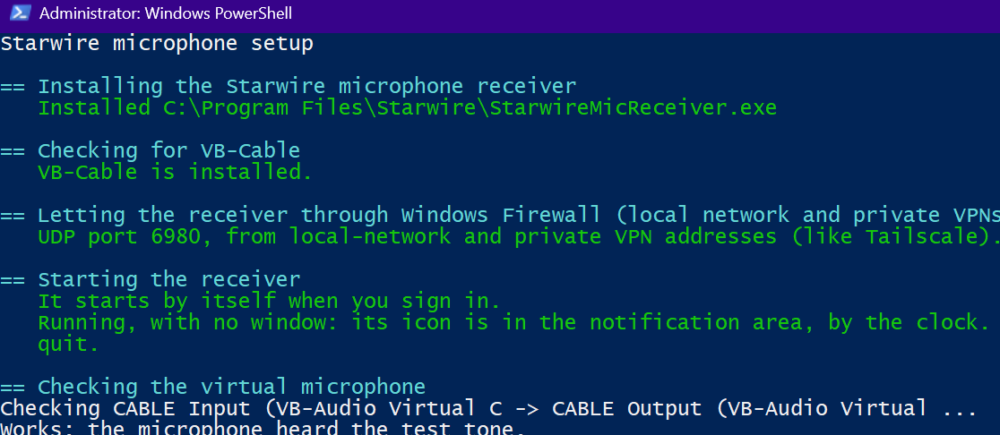
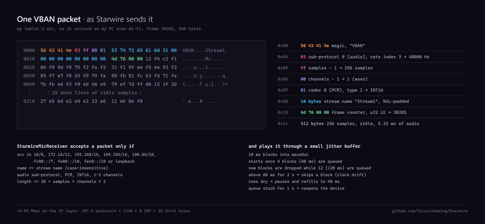
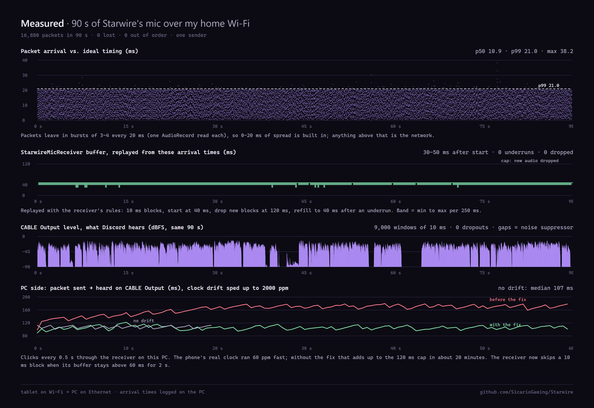
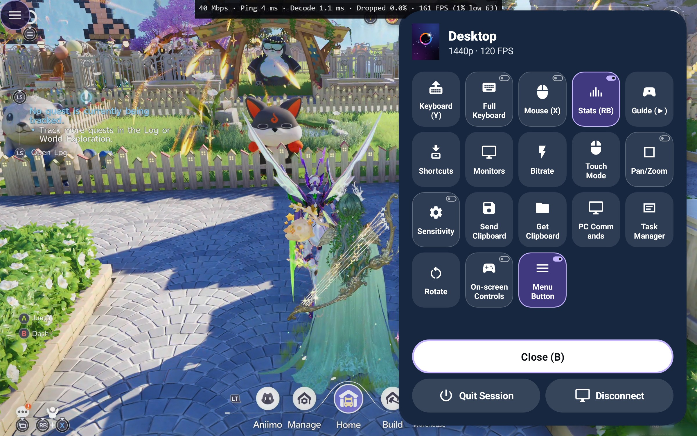
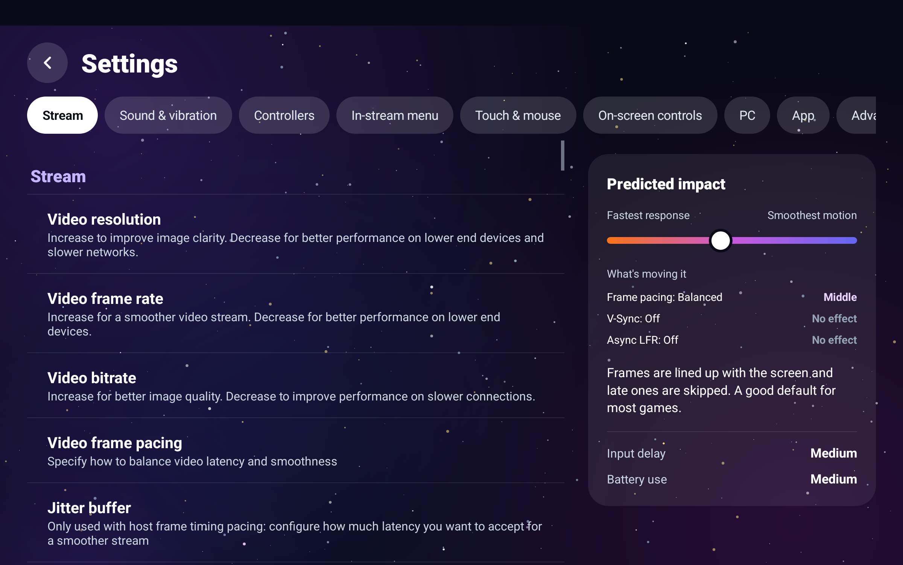
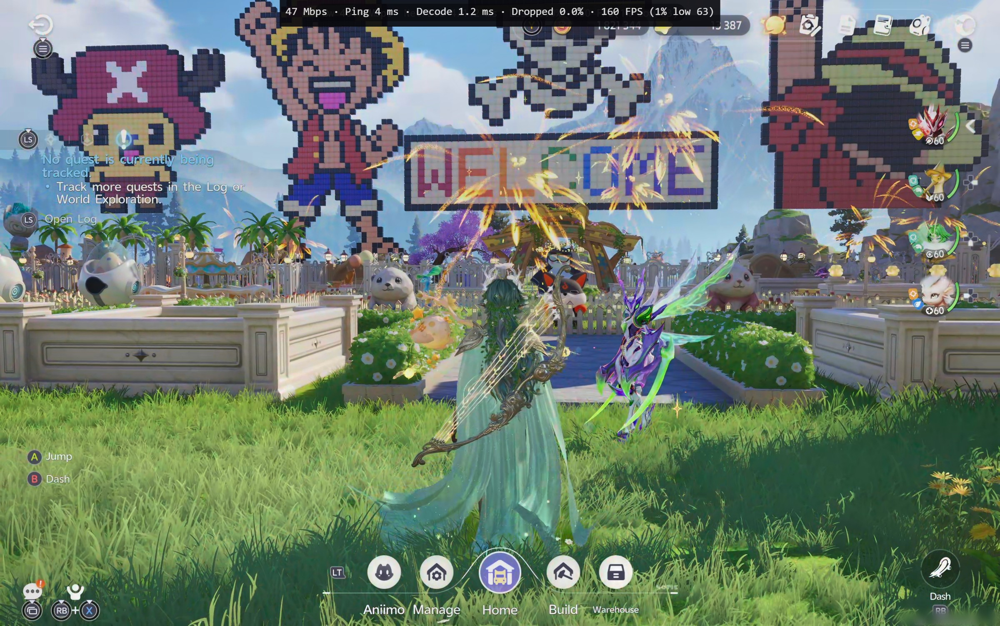

<div align="center">

<h1></h1>

**Stream your PC games to your Android device, with the best of every Moonlight client in one app.**

[](https://github.com/SicarioGaming/Starwire/releases)
[](https://github.com/SicarioGaming/Starwire/releases)
[](LICENSE.txt)

### [⬇ Download Starwire](https://github.com/SicarioGaming/Starwire/releases)



<sub>The whole screen picks up the colour of whatever you select. Games show their own cover art; Desktop and games without art get the Starwire tile, and apps like Steam Big Picture get their own icons.</sub>

</div>

---

## New in 0.2.0: your microphone on the PC, with any host

Mic passthrough was a highly requested feature after the 0.1.0 launch, and one of the last things
keeping a Moonlight stream from feeling like you're really sitting at your PC. Parsec has had it
for years, but with Moonlight it meant switching your PC to a host build that has a mic channel,
like logabell's Apollo fork. Most of us don't want to swap host programs, and I wasn't keen on
giving up a Vibepollo setup that already works flawlessly.

So this works without touching the host: Starwire sends your mic straight to the PC as VBAN
(VB-Audio's network audio format), a small receiver plays it into VB-Cable, a free virtual
microphone, and Discord or the game picks it up as a normal mic. Vibepollo, Sunshine and Apollo
stay exactly as they are, and the mic starts and stops with the stream, with no separate mic app
like WO Mic or AudioRelay to open on your Android device each time.

<p align="center">

</p>

1. On the PC, download **Starwire-Microphone-for-Windows.zip** from the
   [latest release](https://github.com/SicarioGaming/Starwire/releases/latest), unzip it and
   double-click `setup-microphone.cmd`. It needs nothing installed first: it downloads VB-Cable
   from VB-Audio (and checks VB-Audio signed it), builds the receiver with the compiler that comes
   with Windows, lets it through the firewall for local and private VPN addresses only, starts it
   when you sign in and checks the virtual mic works. The receiver has no window, just an icon by
   the clock. [Full guide](windows/README.md).
2. In Discord or the game, choose **CABLE Output** as the microphone.
3. In Starwire: **Settings → Sound & vibration → Send my microphone**.

<p align="center">

<br>
<sub>All of this is automatic: one double-click runs the PowerShell setup, which builds and starts the receiver, installs VB-Cable if it's missing, adds the firewall rule and checks the virtual mic. This is it finishing on my PC.</sub>
</p>

The receiver has no window: right-click its icon by the clock to check the virtual mic, play a test
tone for Discord's mic test or quit (or end it in Task Manager). Measured on my tablet over Wi-Fi:
16,880 packets in 90 seconds with none lost, the receiver's buffer holding at 30 to 50 ms, and
about 0.85 Mbps of upload.

The audio isn't encrypted, so Starwire only sends it to a PC on your local network or over a
private VPN. If you want the mic encrypted, use [Tailscale](https://tailscale.com/) or something
like it, which many of us already use to stream away from home. If your PC runs
[logabell's Apollo build](https://github.com/logabell/apollo-microphone/releases), you can send it
over the stream itself instead.

<details>
<summary><b>How it works and what I measured</b></summary>

<br>

On the Android device, Starwire records with `AudioRecord` using the `VOICE_COMMUNICATION` source and turns
on the platform echo canceller and noise suppressor where the device has them. It reads 20 ms at a
time and sends 48 kHz 16-bit mono PCM as VBAN over UDP (port 6980 by default): a 28-byte header
and 256 samples per packet, 187.5 packets a second. It sends to the PC you're streaming from, so
there's nothing to type in, and it doesn't ask the host for a mic channel.

On the PC, `StarwireMicReceiver` (one C# file, built on your PC from the source in the zip)
accepts packets only from local-network or private VPN addresses with the right stream name, and
plays them into CABLE Input in 10 ms blocks. Playback starts once 40 ms is queued and never falls
more than 120 ms behind. The device's and the PC's clocks drift apart (60 ppm in my test), so when the buffer
stays above 60 ms for 2 seconds it skips a block to keep the delay down.

<p align="center">

<br>

</p>

- On the PC alone, a packet takes about 107 to 119 ms to be heard on CABLE Output: 40 ms of
  buffer, the rest Windows' audio path. I haven't measured the Android side yet. Swapping waveOut for
  WASAPI should take a chunk off the PC side, and it's planned for the next release.
- Echo cancelling is whatever the device provides, and some Android devices only apply it to
  calls; headphones get around that.
- The setup and receiver are Windows only for now. On Linux, PipeWire's VBAN receive module should
  take the stream (Stream1, UDP 6980), but I haven't tried it.
- The receiver starts when you sign in, not as a service, so it doesn't run on a PC sitting at the
  sign-in screen.

</details>

## Why I made Starwire

I have been exclusively streaming games from my headless PC to client devices for about five
years now. I recently found myself looking for a new Android client, and came upon
[MoreOrLessSoftware](https://github.com/MoreOrLessSoftware)'s
[Moonlight X](https://github.com/MoreOrLessSoftware/moonlight-android), which includes direct
frame pacing and PyroWave support. It had a noticeable impact on my stream quality, even without
using PyroWave (I don't have the connection strength to use it in practice), but I wondered how
the stream could perform if it had the Fast V-Sync, LFR, Async, and Codec options that
Artemis/Artemide has. I also missed some QoL features that the recent Windows forks have adopted
that seem to be lagging in terms of an Android client equivalent.

Back-end development started from
[Moonlight X](https://github.com/MoreOrLessSoftware/moonlight-android)'s fast video pipeline, adds
the touchscreen tools from [Artemide](https://github.com/derflacco/moonlight-android) and
[Artemis](https://github.com/ClassicOldSong/moonlight-android), and picks up favourite features
from [Moonlight V+](https://github.com/qiin2333/moonlight-vplus),
[Moonlit Artemis](https://github.com/4had45/moonlit-artemis) and
[Moonlight X Turnip](https://github.com/NoCrypt/moonlight-x-turnip). I then gave it a refreshed UI
that draws from some of the trends coming out of Silicon Valley these days. It installs next to
any Moonlight you already have, so you can try it without giving anything up.

## Features

<table>
<tr>
<td width="50%" valign="top">

### 🎨 A look that follows your game
The screens take their colour from the game you've picked. Games without cover art each get
their own take on the Starwire tile, and apps like Steam Big Picture get their own icons. Your
last game is ready to go with one tap, with its stream settings right under its name, and a Quit
button sits beside Resume while it runs.

### 🎮 Everything during a stream, one tap away
Open the menu with the floating button, a three-finger tap or by holding Select on a
controller. Keyboard, full on-screen keyboard, mouse modes, zoom, key shortcuts, monitor
switching, bitrate, clipboard: it's all in one grid, and works with a controller too. Anything
that turns on and off has a small switch, so you can see what's on at a glance.

### ⚡ Fast and smooth
A Vulkan renderer, the PyroWave codec, and low-latency options like Warp Drive, Fast V-Sync and
async decoding for when every millisecond counts.

</td>
<td width="50%" valign="top">


<sub>The in-stream menu over Aniimo on my tablet. Stats and the menu button are switched on. Aniimo © Pawprint Studio.</sub>

</td>
</tr>
<tr>
<td width="50%" valign="top">


<sub>Redesigned settings, with the Predicted impact panel on the right.</sub>

</td>
<td width="50%" valign="top">

### 🧭 Feature-packed and intuitive settings
Sections with plain names (Stream, Sound & vibration, Controllers…), and a **Predicted impact**
panel that shows whether your choices lean towards fastest response or smoothest motion, and
which setting is pushing it which way. Tap a setting that came from another fork and a small
line under the panel says where it came from and who made it.

### 🖐 Made for touchscreens
Pinch to zoom anytime, trackpad modes, long-press to right-click, an on-screen keyboard with
every key, and the option to hide the PC's mouse pointer while you play.

### 📳 Feel the bass
Audio haptics turns a game's bass into vibration on your device or controller.

### 🎙 Your microphone on the PC
Talk in game chat or Discord through your device's microphone, **with Vibepollo, Sunshine or
Apollo as they are**: one setup script on the PC, one switch in Starwire. See
[New in 0.2.0](#new-in-020-your-microphone-on-the-pc-with-any-host) for how it works and how to
set it up.

</td>
</tr>
</table>

<p align="center">

<br>
<sub>Aniimo streamed to my RedMagic Astra, with the Lite stats line at the top. Aniimo © Pawprint Studio.</sub>
</p>

## Get started

1. **Set up your PC.** I use [Vibepollo](https://github.com/Nonary/Vibepollo); it enables every
   feature. [Apollo](https://github.com/ClassicOldSong/Apollo) works too, and
   [Sunshine](https://github.com/LizardByte/Sunshine) works for everything except a few extras
   (clipboard sharing, PC commands, Virtual Display and changing the bitrate mid-stream).
2. **Install Starwire.** Download the latest `Starwire-…apk` from the
   [Releases page](https://github.com/SicarioGaming/Starwire/releases) and open it.
3. **Pair.** Tap your PC, then type the PIN Starwire shows into your host's PIN page (usually
   `https://localhost:47990`). You only do this once.
4. **Play.** Tap a game, then **Play**.

Android 5.0+. PyroWave and the custom Turnip driver need a 64-bit ARM device. Updates from the
Releases page install over the top and keep your settings, and
[Obtainium](https://github.com/ImranR98/Obtainium) can keep it updated for you.

## Development

I made Starwire as a vibecoding exercise after experiencing the wonderful software that is
Vibepollo. I decided what the app should do and how it should look, and
[Claude Code](https://claude.com/claude-code) wrote the code. I also
used [REA](https://github.com/morluto/rea) by morluto to look inside the other apps and see how
their features work. Every feature is tested on my RedMagic Astra with a GameSir G8+ and on my
Galaxy Z Fold 6 before it goes in.

## Changelog

**2026/10/22:** [Version 0.2.0](https://github.com/SicarioGaming/Starwire/releases/tag/v0.2.0)
sends your microphone to the PC with any host (Vibepollo, Sunshine, Apollo), through a small
receiver and VB-Cable that one setup script installs. It also fits more Android devices
(settings were blank on narrow screens like a Galaxy Z Fold's cover screen, and the game screen's
header now scrolls away), adds a short "Impact:" line to the settings that affect latency and
performance, tidies the stream menu with on/off switches and a smaller floating button that
also closes it, puts a Quit button beside Resume, gives each game without cover art its own
Starwire tile, and fixes a crash when tapping a running Desktop tile. The release page has the full
list.

**2026/10/22:** [Version 0.1.2](https://github.com/SicarioGaming/Starwire/releases/tag/v0.1.2)
has been released, and fixes an error that caused the client to crash upon loading the list of
apps. To update, download the new APK and open it on your device. You will receive a prompt to
update the existing app, which will retain existing settings. Obtainium users should receive the
update automatically.

---

## Where every feature comes from

Each feature below says where it came from:

- **Ported from *project* (*author*)**: that project's code, brought into Starwire and adapted.
- **Idea from *project* (*author*)**: inspired by that project, but written new for Starwire.
- **New in Starwire**: written for Starwire.

Where a feature started in an older version and was carried forward (for example Artemis →
Artemide), both are named. Features marked **(Apollo / Vibepollo)** need an Apollo-based host.

<details>
<summary><b>Cover Glow, the new design</b></summary>

*New in Starwire.*

- **Game screen:** the selected game shown large with its cover, name, Play/Resume and its
  stream settings as small tags. It starts on the game running on the PC, otherwise the one you
  played last. While a game runs, Quit sits beside Resume. The top scrolls away with your games,
  leaving a slim bar with the selected game and its Play button.
- **Colours from the cover:** the background and glow take the game's cover colour and fade
  between games. White text stays readable on every colour.
- **Icons for apps without cover art:** Desktop, Steam Big Picture, Playnite and similar apps get
  an icon tile in their own colour instead of the host's plain default image. **Settings → App →
  App covers** can also use icons for every app, or only ever the PC's covers.
- **Starwire tiles for games without cover art:** each game gets its own take on the tile,
  worked out from its name (colour, ring angle, moon, glow and stars), so a row of them doesn't
  look the same.
- **A little flair:** the Starwire wordmark and the ring around the selected game slowly flow
  through a rainbow, and a starfield with a few twinkling stars sits behind the screens. Covers
  have soft rounded corners, arrive one after another and give a little when you press them, and
  the selected cover floats gently. The looping animations pause while you stream.
- **PC list:** frosted cards and a frosted quick-settings bar.
- **Settings:** section buttons that jump to each section and follow you as you scroll, plain
  section names (in English), and the Predicted impact panel on wide screens. It compares the
  choices rather than measuring them.
- **In-stream menu:** a side sheet in the game's colour with a grid of tools, usable with a
  controller.

</details>

<details>
<summary><b>In-stream menu</b></summary>

The menu itself, its quick actions and custom commands come from Moonlight X
(MoreOrLessSoftware). Starwire adds:

| Feature | Source |
| --- | --- |
| Floating menu button (tap to open, drag to move) | Ported from Artemis (Yukino Song / ClassicOldSong), via Artemide |
| A smaller floating button that stays see-through until you touch it, and closes the menu too | New in Starwire, on the Artemis button |
| On/off switches on the items that toggle something, and the menu stays open when you tap them | New in Starwire |
| The menu header shows the game's cover art, or a Starwire tile for Desktop and games without art | New in Starwire |
| Shortcuts page: Esc, F11, Alt+F4, Alt+Enter, Ctrl+V, Win, Win+D, Win+G, Ctrl+Alt+Tab, Shift+Tab, Win+Shift+Left, Ctrl+Alt+Shift+F1/F12, Win+Alt+B | Ported from Axixi2233's Moonlight fork (axi), via Artemis and Artemide |
| Custom shortcuts imported from a file (same JSON format) | Format from Axixi2233's fork (axi) and Artemis (Yukino Song); importer written new for Starwire |
| Task Manager (Ctrl+Shift+Esc) | Ported from Artemis (Yukino Song), via Artemide |
| Rotate screen, Pan/Zoom mode (pinch to zoom, drag to pan, double-tap to reset) | Ported from Artemis (Yukino Song), via Artemide |
| Touch mode picker (multi-touch, direct touch, natural and gaming trackpad, disabled, swapped clicks) | Ported from Artemis (Yukino Song), via Artemide |
| Trackpad sensitivity, toggled from the menu | Ported from Artemis (Yukino Song) and Axixi2233's fork, via Artemide |
| Send / get clipboard **(Apollo / Vibepollo)** | Ported from Artemis (Yukino Song), via Artemide |
| PC commands (run the host's server commands) **(Apollo / Vibepollo)** | Ported from Artemis (Yukino Song), via Artemide |
| On-screen full keyboard (82 keys, sticky Ctrl/Alt/Shift/Win, vibration) | Ported from Axixi2233's fork (axi) and Artemis (Yukino Song), via Artemide |
| On-screen controller toggle | Ported from Artemis (Yukino Song), via Artemide |
| Monitor switcher (Monitor 1–6, using the host's Ctrl+Alt+Shift+F1… shortcuts) | Idea from Moonlit Artemis (Mohammad Forhad / 4had45) |
| Change bitrate mid-stream **(Vibepollo)** | Idea from Moonlight V+ (qiin2333) |

</details>

<details>
<summary><b>Streaming and video</b></summary>

| Feature | Source |
| --- | --- |
| Vulkan renderer with host frame timing, PyroWave codec | From Moonlight X (MoreOrLessSoftware) |
| Custom Vulkan driver (Turnip) for PyroWave | Ported from Moonlight X Turnip (ncpt / NoCrypt), uses libadrenotools (Billy Laws / bylaws). Starwire rebuilds libadrenotools from source, refuses files that aren't 64-bit ARM libraries, and falls back to the system driver if the custom one can't run PyroWave |
| Warp Drive / Warp 2 frame pacing (2x / 4x FPS from the PC, newest frame shown) | Ported from Artemis (Yukino Song), via Artemide |
| Fast V-Sync (Artemide's Nano Pacer) | Ported from Artemide (derflacco) |
| V-Sync (one setting: Off, V-Sync, Fast V-Sync) | V-Sync for the direct renderer is new in Starwire; Fast V-Sync as above |
| Sync: LFR | Ported from Artemide (derflacco) |
| Async decode and Async: LFR | Ported from Artemide (derflacco) |
| Ultra Low Latency: MediaTek's own ultra-low-latency mode follows the setting, and low latency is set again after the decoder starts | Ported from Artemide (derflacco). The base option and its Snapdragon/Exynos/Amlogic flags are from Moonlight X (MoreOrLessSoftware) and Artemis |
| Virtual Display: "Display on the PC" setting, "Start in Virtual/Primary Display" **(Apollo / Vibepollo)** | Ported from Artemis (Yukino Song), via Artemide |
| Prevent Packet Loss (keeps Wi-Fi awake during streams) | Option from Artemis (Yukino Song), via Artemide; rewritten for Starwire as a small keep-alive packet |
| Lite performance overlay (one compact line: data rate, ping, decode time, dropped frames, FPS) | Ported from Axixi2233's fork (axi), via Artemis and Artemide; the plain wording is new in Starwire |
| 1% low FPS in the stats | Idea from Moonlight V+ (qiin2333) and Moonlight X Turnip (NoCrypt) |

</details>

<details>
<summary><b>Input and feel</b></summary>

| Feature | Source |
| --- | --- |
| Pinch to zoom anytime, outside Pan/Zoom mode | Idea from Moonlit Artemis (Mohammad Forhad / 4had45); uses Artemis's pan/zoom code (Yukino Song) |
| Automatic clipboard sync (send yours when the stream starts, copy the PC's when you leave) **(Apollo / Vibepollo)** | Ported from Artemis (Yukino Song), via Artemide |
| Audio haptics: the game's bass becomes vibration on the device and/or the controller | Idea from Moonlight V+ (qiin2333); written new for Starwire |
| Hide PC cursor (never / while touching / always) **(Vibepollo)** | New in Starwire |
| Long-press to right-click in gaming trackpad mode | New in Starwire |
| Settings, the game screen and the stream menu fit every Android device, down to narrow screens like a Galaxy Z Fold's cover screen; the game screen's header scrolls away with the covers | New in Starwire |
| An "Impact:" line under settings that change latency, smoothness, picture quality or battery | New in Starwire |
| On a foldable's inner screen, the stream follows the device instead of forcing landscape | Idea from [Moonlight Fold](https://github.com/sblocktechnologies/moonlight-fold) (sblocktechnologies) and [moonlight-android#1613](https://github.com/moonlight-stream/moonlight-android/pull/1613) |
| Send your microphone to the PC with any host: a VBAN stream to Starwire's receiver on the PC, which plays it into VB-Cable (local network or private VPN only). The receiver has no window, just an icon by the clock with a mic check and a test tone | New in Starwire, with its Windows receiver and setup script; VBAN is VB-Audio's network audio format |
| Or send it over the stream itself, with a choice of microphone **(needs [logabell's Apollo build](https://github.com/logabell/apollo-microphone/releases) on the PC)** | Ported from logabell's Artemis and moonlight-common-c microphone changes ([Artemis PR #537](https://github.com/ClassicOldSong/moonlight-android/pull/537)); echo-cancelled capture is new in Starwire |
| Per-game settings for the new options (codec, V-Sync, LFR, async decode, display, touch mode, cursor, audio haptics) | Extends Moonlight X's per-app settings (MoreOrLessSoftware) |

</details>

<details>
<summary><b>Kept from Moonlight X, and not included</b></summary>

**Kept from Moonlight X** (all by MoreOrLessSoftware): Quick Launch apps, per-app settings,
brightness slider, bitrate and stats overrides, Force HDR, the in-stream overlay menu with custom
commands, the improved stats overlay, and Ultra Low Latency. See the
[Moonlight X README](https://github.com/MoreOrLessSoftware/moonlight-android).

**Not included:** Artemide's customisable on-screen key buttons, and its other MediaTek
queue/preload values and NVIDIA Tegra and legacy Qualcomm decoder extras.

</details>

## Credits

Anything that came from another Moonlight version is that author's work. Please go give their
repos a star:

| Project | Author | Used for |
| --- | --- | --- |
| [Moonlight Android](https://github.com/moonlight-stream/moonlight-android) | Cameron Gutman and contributors | The original client everything here is built on |
| [Moonlight X](https://github.com/MoreOrLessSoftware/moonlight-android) | MoreOrLessSoftware | The base of Starwire: Vulkan renderer, PyroWave, overlay menu, per-app settings, Quick Launch |
| [Artemis](https://github.com/ClassicOldSong/moonlight-android) | Yukino Song (ClassicOldSong) | Pan/zoom, touch modes, clipboard, server commands, Virtual Display, Warp pacing, floating button, and more (via Artemide) |
| [Artemide](https://github.com/derflacco/moonlight-android) | derflacco | Nano Pacer / Fast V-Sync, Sync and Async LFR, async decode, MediaTek low-latency work, and the version of all the Artemis features above that Starwire ported |
| [Moonlight (Axixi2233 fork)](https://github.com/Axixi2233/moonlight-android) | Axixi2233 | Full keyboard, shortcuts list, Lite overlay, shortcut file format (via Artemis) |
| [Moonlight X Turnip](https://github.com/NoCrypt/moonlight-x-turnip) | ncpt (NoCrypt) | Custom Turnip Vulkan driver for PyroWave |
| [Moonlight V+](https://github.com/qiin2333/moonlight-vplus) | qiin2333 | Ideas: bitrate mid-stream, audio haptics, 1% lows |
| [Moonlit Artemis](https://github.com/4had45/moonlit-artemis) | Mohammad Forhad (4had45) | Ideas: monitor switcher, pinch to zoom anytime |
| [Moonlight Fold](https://github.com/sblocktechnologies/moonlight-fold) | sblocktechnologies | Idea: letting the stream follow a foldable's inner screen |
| [Apollo microphone](https://github.com/logabell/apollo-microphone) | logabell | The in-stream microphone: the Android capture, the moonlight-common-c changes, and the Apollo build that receives it |
| [VBAN and VB-Cable](https://vb-audio.com/Cable/) | VB-Audio (Vincent Burel) | VBAN, the network audio format Starwire's microphone uses, and VB-Cable, the virtual microphone the receiver plays into (donationware) |
| [PyroWave](https://github.com/Themaister/pyrowave) | Hans-Kristian Arntzen (Themaister) | The PyroWave codec (MIT) |
| [libadrenotools](https://github.com/bylaws/libadrenotools) | Billy Laws (bylaws) | Loading a custom Adreno Vulkan driver (BSD-2-Clause) |
| [Vibepollo](https://github.com/Nonary/Vibepollo) | Chase Payne (Nonary) | The host Starwire is developed with (fork of Apollo) |
| [Apollo](https://github.com/ClassicOldSong/Apollo) / [Sunshine](https://github.com/LizardByte/Sunshine) | ClassicOldSong / LizardByte | The hosts Vibepollo is built on |
| [Claude Code](https://claude.com/claude-code) | Anthropic | Writing the Starwire code, ports, redesign and tests |
| [REA](https://github.com/morluto/rea) | morluto | Reverse-engineering and analysis (MIT) |

If I've credited something wrongly or missed you, please let me know.

Bug reports and ideas are very welcome as a
[GitHub issue](https://github.com/SicarioGaming/Starwire/issues) or in
[Discussions](https://github.com/SicarioGaming/Starwire/discussions).

## More details

<details>
<summary><b>Device support</b></summary>

Android 5.0 or newer, on any CPU type. Some features need a recent device (async decoding, the
Vulkan renderer), and PyroWave and the custom Turnip driver need a 64-bit ARM device
(`arm64-v8a`), since their libraries are only built for that. Updates install over the top with
your settings kept, as long as they come from these releases. Tools such as
[Obtainium](https://github.com/ImranR98/Obtainium) can keep it updated straight from the
Releases page.

The microphone's PC side (the receiver and its setup) needs Windows 10 or 11. Sending over the
stream instead needs logabell's Apollo build on the PC.

</details>

<details>
<summary><b>Building from source</b></summary>

1. Install Android Studio, the Android NDK (the version in `app/build.gradle`) and a JDK 17 or
   newer.
2. Clone with the submodules:
   ```bash
   git clone --recursive https://github.com/SicarioGaming/Starwire.git
   ```
   Starwire uses its own fork of
   [moonlight-common-c](https://github.com/SicarioGaming/moonlight-common-c) (branch `main`),
   which adds the calls for PC commands and Prevent Packet Loss, and logabell's in-stream
   microphone.
3. Create `local.properties` in the project folder with `ndk.dir=` set to your NDK folder.
4. Build a debug APK with `./gradlew assembleNonRootDebug`. It installs as "Starwire (Debug)"
   (`com.starwire.debug`).
5. On-device tests: `./gradlew connectedNonRootDebugAndroidTest`.

**Signed release builds** use a key that's never committed. Put its details in
`keystore.properties` in the project folder (it's in `.gitignore`):

```properties
storeFile=starwire-release.jks
storePassword=...
keyAlias=starwire
keyPassword=...
```

or set `STARWIRE_KEYSTORE`, `STARWIRE_KEYSTORE_PASSWORD`, `STARWIRE_KEY_ALIAS` and
`STARWIRE_KEY_PASSWORD`. Then run `./gradlew assembleNonRootRelease`. Without a key, release
builds come out unsigned.

The libadrenotools and PyroWave libraries are included prebuilt, with the scripts that build
them from their upstream source next to them.

The microphone receiver for Windows and its setup script are in [`windows/`](windows). There's
nothing to build there by hand: the setup compiles the receiver on the PC.

</details>

## Licence

GPL-3.0, like Moonlight and every version it builds on. See [LICENSE.txt](LICENSE.txt). PyroWave
(MIT) and libadrenotools (BSD-2-Clause) keep their own licences.
