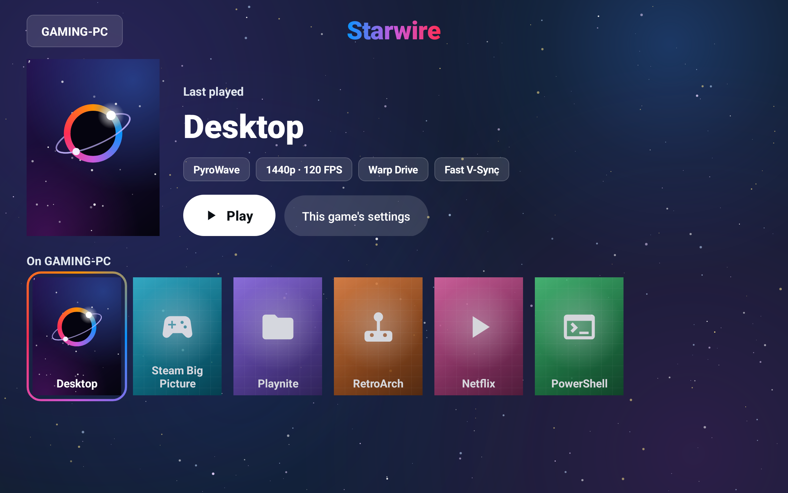
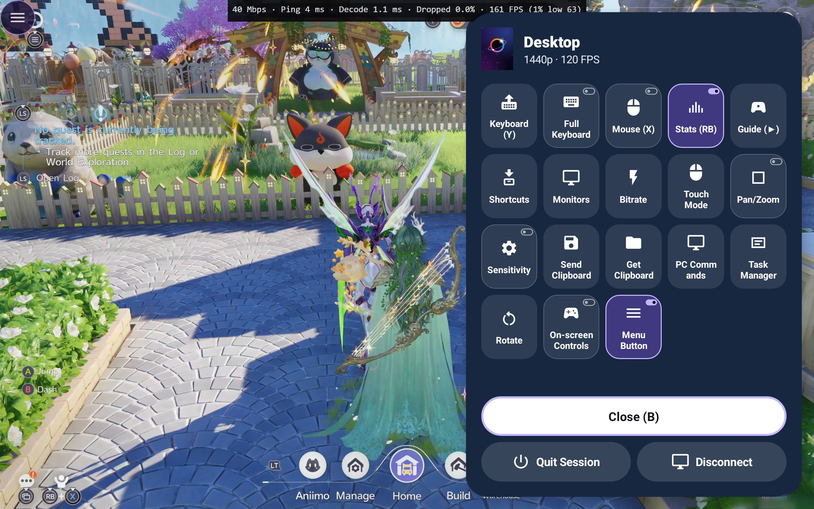

<div align="center">

<h1></h1>

**Stream your PC games to your Android phone or tablet, with the best of every Moonlight client in one app.**

[](https://github.com/SicarioGaming/Starwire/releases)
[](https://github.com/SicarioGaming/Starwire/releases)
[](LICENSE.txt)

### [⬇ Download Starwire](https://github.com/SicarioGaming/Starwire/releases)



<sub>The whole screen picks up the colour of whatever you select. Games show their own cover art; Desktop and games without art get the Starwire tile, and apps like Steam Big Picture get their own icons.</sub>

</div>

---

## Why I made Starwire

I have been exclusively streaming games from my headless PC to client devices for about five
years now. I recently found myself looking for a new Android client, and came upon
[MoreOrLessSoftware](https://github.com/MoreOrLessSoftware)'s
[Moonlight X](https://github.com/MoreOrLessSoftware/moonlight-android), which includes direct
frame pacing and PyroWave support. It had a noticeable impact on my stream quality, even without
using PyroWave (I don't have the connection strength to use it in practice), but I wondered how
the stream could perform if it had the Fast V-Sync, LFR, Async, and Codec options that
Artemis/Artemide has. I also missed some QoL features that the recent Windows forks have adopted
that seem to be lagging in terms of an Android client equivalent.

The community has built some brilliant solutions as we continue down the Nth generation of forks,
but I found each one is great at something different: one has the smoothest video, another has
the best touch controls, another has the handiest in-stream menu. I got tired of having to pick
between them, so I made Starwire. Give it a try and see if it warrants replacing your current
client; it has been a godsend to my use case while testing.

Back-end development started from
[Moonlight X](https://github.com/MoreOrLessSoftware/moonlight-android)'s fast video pipeline, adds
the touchscreen tools from [Artemide](https://github.com/derflacco/moonlight-android) and
[Artemis](https://github.com/ClassicOldSong/moonlight-android), and picks up favourite features
from [Moonlight V+](https://github.com/qiin2333/moonlight-vplus),
[Moonlit Artemis](https://github.com/4had45/moonlit-artemis) and
[Moonlight X Turnip](https://github.com/NoCrypt/moonlight-x-turnip). I then gave it a refreshed UI
that draws from some of the trends coming out of Silicon Valley these days. It installs next to
any Moonlight you already have, so you can try it without giving anything up.

<sub>Starwire was briefly called Voidlink. An iOS Moonlight client already uses that name, so I
changed it early to avoid confusion.</sub>

## Features

<table>
<tr>
<td width="50%" valign="top">

### 🎨 A look that follows your game
The screens take their colour from the game you've picked, and apps without cover art get their
own icons. Your last game is ready to go with one tap, with its stream settings right under its
name.

### 🎮 Everything during a stream, one tap away
Open the menu with the floating button, a three-finger tap or by holding Select on a
controller. Keyboard, full on-screen keyboard, mouse modes, zoom, key shortcuts, monitor
switching, bitrate, clipboard: it's all in one grid, and works with a controller too. Anything
that turns on and off has a small switch, so you can see what's on at a glance.

### ⚡ Fast and smooth
A Vulkan renderer, the PyroWave codec, and low-latency options like Warp Drive, Fast V-Sync and
async decoding for when every millisecond counts.

</td>
<td width="50%" valign="top">


<sub>The in-stream menu over Aniimo on my tablet. Stats and the menu button are switched on. Aniimo © Pawprint Studio.</sub>

</td>
</tr>
<tr>
<td width="50%" valign="top">


<sub>Redesigned settings, with the Predicted impact panel on the right.</sub>

</td>
<td width="50%" valign="top">

### 🧭 Feature-packed and intuitive settings
Sections with plain names (Stream, Sound & vibration, Controllers…), and a **Predicted impact**
panel that shows whether your choices lean towards fastest response or smoothest motion, and
which setting is pushing it which way. Tap a setting that came from another fork and a small
line under the panel says where it came from and who made it.

### 🖐 Made for touchscreens
Pinch to zoom anytime, trackpad modes, long-press to right-click, an on-screen keyboard with
every key, and the option to hide the PC's mouse pointer while you play.

### 📳 Feel the bass
Audio haptics turns a game's bass into vibration on your device or controller.

</td>
</tr>
</table>

<p align="center">

<br>
<sub>Aniimo streamed to my RedMagic Astra, with the Lite stats line at the top. Aniimo © Pawprint Studio.</sub>
</p>

## Get started

You'll need a Windows PC to stream from, and your Android device on the same Wi-Fi network.

### 1. Set up your PC
Install a streaming host on the PC. I use [**Vibepollo**](https://github.com/Nonary/Vibepollo);
it enables every feature. [Apollo](https://github.com/ClassicOldSong/Apollo) works too, and
[Sunshine](https://github.com/LizardByte/Sunshine) works for everything except a few extras
(clipboard sharing, PC commands, Virtual Display and changing the bitrate mid-stream).

### 2. Install Starwire
On your phone or tablet, open the
[**Releases page**](https://github.com/SicarioGaming/Starwire/releases), download the latest
`Starwire-…apk` and open it. Android will ask you to allow installing apps from your browser
or file manager; allow it, then tap **Install**.

### 3. Pair with your PC
Open Starwire and your PC appears in the list (if it doesn't, tap **+** and type the PC's IP
address). Tap it and Starwire shows a **PIN**. On the PC, open your host's web page (usually
`https://localhost:47990`), go to the **PIN** page and type it in. You only do this once.

### 4. Play
Tap your PC, then tap a game to bring it up, and tap **Play**. During a stream, the floating
button, a three-finger tap or holding **Select** on your controller opens the menu.

## Development

I made Starwire as a vibecoding exercise after experiencing the wonderful software that is
Vibepollo. I decided what the app should do and how it should look, and
[Claude Code](https://claude.com/claude-code) (Anthropic's coding tool) wrote the code. I also
used [REA](https://github.com/morluto/rea) by morluto to look inside the other apps and see how
their features work. Every feature is tested on my RedMagic Astra with a GameSir G8+ before it
goes in. Anything that came from another Moonlight version is that author's work, and I've
credited every one of them below.

---

## Where every feature comes from

Each feature below says where it came from:

- **Ported from *project* (*author*)**: that project's code, brought into Starwire and adapted.
- **Idea from *project* (*author*)**: inspired by that project, but written new for Starwire.
- **New in Starwire**: written for Starwire.

Where a feature started in an older version and was carried forward (for example Artemis →
Artemide), both are named. Features marked **(Apollo / Vibepollo)** need an Apollo-based host.

<details>
<summary><b>Cover Glow, the new design</b></summary>

*New in Starwire.*

- **Game screen:** the selected game shown large with its cover, name, Play/Resume and its
  stream settings as small tags. It starts on the game running on the PC, otherwise the one you
  played last.
- **Colours from the cover:** the background and glow take the game's cover colour and fade
  between games. White text stays readable on every colour.
- **Icons for apps without cover art:** Desktop, Steam Big Picture, Playnite and similar apps get
  an icon tile in their own colour instead of the host's plain default image. **Settings → App →
  App covers** can also use icons for every app, or only ever the PC's covers.
- **A little flair:** the Starwire wordmark and the ring around the selected game slowly flow
  through a rainbow, and a faint dot grid sits behind the screens.
- **PC list:** frosted cards and a frosted quick-settings bar.
- **Settings:** section buttons that jump to each section and follow you as you scroll, plain
  section names (in English), and the Predicted impact panel on wide screens. It compares the
  choices rather than measuring them.
- **In-stream menu:** a side sheet in the game's colour with a grid of tools, usable with a
  controller.

</details>

<details>
<summary><b>In-stream menu</b></summary>

The menu itself, its quick actions and custom commands come from Moonlight X
(MoreOrLessSoftware). Starwire adds:

| Feature | Source |
| --- | --- |
| Floating menu button (tap to open, drag to move) | Ported from Artemis (Yukino Song / ClassicOldSong), via Artemide |
| Shortcuts page: Esc, F11, Alt+F4, Alt+Enter, Ctrl+V, Win, Win+D, Win+G, Ctrl+Alt+Tab, Shift+Tab, Win+Shift+Left, Ctrl+Alt+Shift+F1/F12, Win+Alt+B | Ported from Axixi2233's Moonlight fork (axi), via Artemis and Artemide |
| Custom shortcuts imported from a file (same JSON format) | Format from Axixi2233's fork (axi) and Artemis (Yukino Song); importer written new for Starwire |
| Task Manager (Ctrl+Shift+Esc) | Ported from Artemis (Yukino Song), via Artemide |
| Rotate screen, Pan/Zoom mode (pinch to zoom, drag to pan, double-tap to reset) | Ported from Artemis (Yukino Song), via Artemide |
| Touch mode picker (multi-touch, direct touch, natural and gaming trackpad, disabled, swapped clicks) | Ported from Artemis (Yukino Song), via Artemide |
| Trackpad sensitivity, toggled from the menu | Ported from Artemis (Yukino Song) and Axixi2233's fork, via Artemide |
| Send / get clipboard **(Apollo / Vibepollo)** | Ported from Artemis (Yukino Song), via Artemide |
| PC commands (run the host's server commands) **(Apollo / Vibepollo)** | Ported from Artemis (Yukino Song), via Artemide |
| On-screen full keyboard (82 keys, sticky Ctrl/Alt/Shift/Win, vibration) | Ported from Axixi2233's fork (axi) and Artemis (Yukino Song), via Artemide |
| On-screen controller toggle | Ported from Artemis (Yukino Song), via Artemide |
| Monitor switcher (Monitor 1–6, using the host's Ctrl+Alt+Shift+F1… shortcuts) | Idea from Moonlit Artemis (Mohammad Forhad / 4had45) |
| Change bitrate mid-stream **(Vibepollo)** | Idea from Moonlight V+ (qiin2333) |

</details>

<details>
<summary><b>Streaming and video</b></summary>

| Feature | Source |
| --- | --- |
| Vulkan renderer with host frame timing, PyroWave codec | From Moonlight X (MoreOrLessSoftware) |
| Custom Vulkan driver (Turnip) for PyroWave | Ported from Moonlight X Turnip (ncpt / NoCrypt), uses libadrenotools (Billy Laws / bylaws). Starwire rebuilds libadrenotools from source, refuses files that aren't 64-bit ARM libraries, and falls back to the system driver if the custom one can't run PyroWave |
| Warp Drive / Warp 2 frame pacing (2x / 4x FPS from the PC, newest frame shown) | Ported from Artemis (Yukino Song), via Artemide |
| Fast V-Sync (Artemide's Nano Pacer) | Ported from Artemide (derflacco) |
| V-Sync (one setting: Off, V-Sync, Fast V-Sync) | V-Sync for the direct renderer is new in Starwire; Fast V-Sync as above |
| Sync: LFR | Ported from Artemide (derflacco) |
| Async decode and Async: LFR | Ported from Artemide (derflacco) |
| Ultra Low Latency: MediaTek's own ultra-low-latency mode follows the setting, and low latency is set again after the decoder starts | Ported from Artemide (derflacco). The base option and its Snapdragon/Exynos/Amlogic flags are from Moonlight X (MoreOrLessSoftware) and Artemis |
| Virtual Display: "Display on the PC" setting, "Start in Virtual/Primary Display" **(Apollo / Vibepollo)** | Ported from Artemis (Yukino Song), via Artemide |
| Prevent Packet Loss (keeps Wi-Fi awake during streams) | Option from Artemis (Yukino Song), via Artemide; rewritten for Starwire as a small keep-alive packet |
| Lite performance overlay (one compact line) | Ported from Axixi2233's fork (axi), via Artemis and Artemide |
| 1% low FPS in the stats | Idea from Moonlight V+ (qiin2333) and Moonlight X Turnip (NoCrypt) |

</details>

<details>
<summary><b>Input and feel</b></summary>

| Feature | Source |
| --- | --- |
| Pinch to zoom anytime, outside Pan/Zoom mode | Idea from Moonlit Artemis (Mohammad Forhad / 4had45); uses Artemis's pan/zoom code (Yukino Song) |
| Automatic clipboard sync (send yours when the stream starts, copy the PC's when you leave) **(Apollo / Vibepollo)** | Ported from Artemis (Yukino Song), via Artemide |
| Audio haptics: the game's bass becomes vibration on the device and/or the controller | Idea from Moonlight V+ (qiin2333); written new for Starwire |
| Hide PC cursor (never / while touching / always) **(Vibepollo)** | New in Starwire |
| Long-press to right-click in gaming trackpad mode | New in Starwire |
| Per-game settings for the new options (codec, V-Sync, LFR, async decode, display, touch mode, cursor, audio haptics) | Extends Moonlight X's per-app settings (MoreOrLessSoftware) |

</details>

<details>
<summary><b>Kept from Moonlight X, and not included</b></summary>

**Kept from Moonlight X** (all by MoreOrLessSoftware): Quick Launch apps, per-app settings,
brightness slider, bitrate and stats overrides, Force HDR, the in-stream overlay menu with custom
commands, the improved stats overlay, and Ultra Low Latency. See the
[Moonlight X README](https://github.com/MoreOrLessSoftware/moonlight-android).

**Not included:** Artemide's customisable on-screen key buttons, and its other MediaTek
queue/preload values and NVIDIA Tegra and legacy Qualcomm decoder extras.

</details>

## Credits

Starwire wouldn't exist without these projects and the people behind them:

| Project | Author | Used for |
| --- | --- | --- |
| [Moonlight Android](https://github.com/moonlight-stream/moonlight-android) | Cameron Gutman and contributors | The original client everything here is built on |
| [Moonlight X](https://github.com/MoreOrLessSoftware/moonlight-android) | MoreOrLessSoftware | The base of Starwire: Vulkan renderer, PyroWave, overlay menu, per-app settings, Quick Launch |
| [Artemis](https://github.com/ClassicOldSong/moonlight-android) | Yukino Song (ClassicOldSong) | Pan/zoom, touch modes, clipboard, server commands, Virtual Display, Warp pacing, floating button, and more (via Artemide) |
| [Artemide](https://github.com/derflacco/moonlight-android) | derflacco | Nano Pacer / Fast V-Sync, Sync and Async LFR, async decode, MediaTek low-latency work, and the version of all the Artemis features above that Starwire ported |
| [Moonlight (Axixi2233 fork)](https://github.com/Axixi2233/moonlight-android) | Axixi2233 | Full keyboard, shortcuts list, Lite overlay, shortcut file format (via Artemis) |
| [Moonlight X Turnip](https://github.com/NoCrypt/moonlight-x-turnip) | ncpt (NoCrypt) | Custom Turnip Vulkan driver for PyroWave |
| [Moonlight V+](https://github.com/qiin2333/moonlight-vplus) | qiin2333 | Ideas: bitrate mid-stream, audio haptics, 1% lows |
| [Moonlit Artemis](https://github.com/4had45/moonlit-artemis) | Mohammad Forhad (4had45) | Ideas: monitor switcher, pinch to zoom anytime |
| [PyroWave](https://github.com/Themaister/pyrowave) | Hans-Kristian Arntzen (Themaister) | The PyroWave codec (MIT) |
| [libadrenotools](https://github.com/bylaws/libadrenotools) | Billy Laws (bylaws) | Loading a custom Adreno Vulkan driver (BSD-2-Clause) |
| [Vibepollo](https://github.com/Nonary/Vibepollo) | Chase Payne (Nonary) | The host Starwire is developed with (fork of Apollo) |
| [Apollo](https://github.com/ClassicOldSong/Apollo) / [Sunshine](https://github.com/LizardByte/Sunshine) | ClassicOldSong / LizardByte | The hosts Vibepollo is built on |
| [Claude Code](https://claude.com/claude-code) | Anthropic | Writing the Starwire code, ports, redesign and tests |
| [REA](https://github.com/morluto/rea) | morluto | Reverse-engineering and analysis (MIT) |

If I've credited something wrongly or missed you, please open an issue and I'll fix it.

## More details

<details>
<summary><b>Device support</b></summary>

Android 5.0 or newer, on any CPU type. Some features need a recent device (async decoding, the
Vulkan renderer), and PyroWave and the custom Turnip driver need a 64-bit ARM device
(`arm64-v8a`), since their libraries are only built for that. Updates install over the top with
your settings kept, as long as they come from these releases. Tools such as
[Obtainium](https://github.com/ImranR98/Obtainium) can keep it updated straight from the
Releases page.

</details>

<details>
<summary><b>Building from source</b></summary>

1. Install Android Studio, the Android NDK (the version in `app/build.gradle`) and a JDK 17 or
   newer.
2. Clone with the submodules:
   ```bash
   git clone --recursive https://github.com/SicarioGaming/Starwire.git
   ```
   Starwire uses its own fork of
   [moonlight-common-c](https://github.com/SicarioGaming/moonlight-common-c) (branch `main`),
   which adds the calls for PC commands and Prevent Packet Loss.
3. Create `local.properties` in the project folder with `ndk.dir=` set to your NDK folder.
4. Build a debug APK with `./gradlew assembleNonRootDebug`. It installs as "Starwire (Debug)"
   (`com.starwire.debug`).
5. On-device tests: `./gradlew connectedNonRootDebugAndroidTest`.

**Signed release builds** use a key that's never committed. Put its details in
`keystore.properties` in the project folder (it's in `.gitignore`):

```properties
storeFile=starwire-release.jks
storePassword=...
keyAlias=starwire
keyPassword=...
```

or set `STARWIRE_KEYSTORE`, `STARWIRE_KEYSTORE_PASSWORD`, `STARWIRE_KEY_ALIAS` and
`STARWIRE_KEY_PASSWORD`. Then run `./gradlew assembleNonRootRelease`. Without a key, release
builds come out unsigned.

The libadrenotools and PyroWave libraries are included prebuilt, with the scripts that build
them from their upstream source next to them.

</details>

## Licence

GPL-3.0, like Moonlight and every version it builds on. See [LICENSE.txt](LICENSE.txt). PyroWave
(MIT) and libadrenotools (BSD-2-Clause) keep their own licences.
